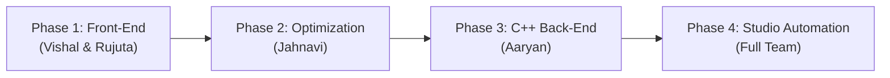

# PYTHIA: Simplified Project Guide & Team Walkthrough
### *Everything your team needs to know for Review 3, Viva, and Code Defense in Plain English*

---

## 1. The 30-Second Elevator Pitch
> **What is PYTHIA?**  
> PYTHIA is a compiler and tool that takes slow, CPU-heavy Python code, automatically converts it into ultra-fast native C++17, proves that the output is 100% correct, and plugs it right back into your Python application—without the developer having to write a single line of C++.
>
> **The Result:** The exact same Python project now runs **12x to 85x faster**.

---

## 2. Why Does This Project Exist? (The Problem)

### Why is Python so slow?
When you write `c = a + b` in Python:
1. Python doesn't just do a CPU addition. It treats `a` and `b` as heavy objects on the heap (`PyObject`), each with metadata and reference counts.
2. The Python interpreter has to check at runtime: *"Is `a` an int? Does `b` support addition? What method should I call?"*
3. It extracts the raw numbers, adds them, allocates a brand-new `PyLongObject` in RAM, and updates garbage collector counters.
4. In loops with millions of iterations, **95% of your CPU time is wasted on Python bookkeeping**, not actual math!

### Why not just use Cython or Numba?
* **Cython:** You have to learn a weird mix of C and Python syntax, create `.pyx` files, and maintain two separate codebases.
* **Numba:** JIT compiles code when it runs, causing huge "warmup freezes", and it breaks if you use normal Python classes or complex logic.
* **Manual C++:** Nobody wants to write manual C-extensions and risk segmentation faults and memory leaks.

**PYTHIA's Solution:** You write normal Python. PYTHIA analyzes it, turns the heavy functions into compiled C++ binaries (`.pyd` on Windows, `.so` on Linux), tests them automatically against Python, and splices them back in.

---

## 3. How PYTHIA Works (The 4 Main Phases)



### Phase 1: Reading & Understanding Python (Front-End)
* **Lexer (`lexer.py`):** Breaks Python code into tokens (`NAME`, `NUMBER`, `INDENT`, `DEDENT`). It keeps a stack of indentation spaces to know where code blocks start and end.
* **Parser (`parser.py`):** Builds an Abstract Syntax Tree (AST)—a tree representation of the code.
* **Type Checker (`typecheck.py`):** Python has dynamic types, but C++ requires strict static types. This phase checks that every variable has a known type (`int`, `float`, `list[int]`, etc.) and catches errors *before* compiling.

### Phase 2: Cleaning Up & Optimizing (Middle-End)
* **Lowering (`lower.py`):** Converts high-level Python tricks (like list comprehensions) into simple `while` loops and explicit arrays (called Primitive IR or PIR).
* **Guard Elision (`optimize.py`):** 
  * Normally in C++, every time you access `arr[i]`, you must check if `i` is out of bounds.
  * In a loop like `for i in range(len(arr)):`, we mathematically *know* `i` is always inside the array.
  * The optimizer strips away those boundary checks. Removing checks allows the CPU to auto-vectorize loops (SIMD) at maximum speed.

### Phase 3: Converting to C++17 & Native Compiling (Back-End)
* **Emitter (`emit_c.py` / `emit_cpp.py`):** Writes out clean, human-readable C++17 code.
  * `int` $\rightarrow$ `int64_t` (raw 64-bit CPU number)
  * `float` $\rightarrow$ `double`
  * `list[int]` $\rightarrow$ `PyListI64` (a flat C++ `std::vector`)
  * `class` $\rightarrow$ C++ `struct` managed by `std::shared_ptr` (zero memory leaks!)
* **PyBind11 Bridge (`libmode.py`):** Generates wrapper code so CPython can call the compiled C++ function seamlessly. It also copies changes back (if a function mutates a list in-place).
* **MinGW Compiler:** Compiles the C++ code with `-O3 -flto` into a `.pyd` binary file.

### Phase 4: Studio Automation & Splicing
* **Profiler (`trace.py`):** Finds the functions taking the most time (hotspots).
* **Oracle Replay (`replay.py`):** Runs the function in Python and C++ with identical test inputs. If the outputs differ by even 1 bit, **it rejects the optimization**.
* **Benchmark (`bench.py`):** Measures execution time. If native code is not at least 1.1x faster, it rejects it (saving you from boundary overhead).
* **Splicer (`splice.py`):** Replaces the original Python function with a 3-line dispatch that calls the fast `.pyd` module.

---

## 4. Who Did What? (Member Responsibility Cheat-Sheet)

If a professor or reviewer asks you questions during Viva, here is exactly what you own:

### 👤 Member 1: Vishal Vivek (Team Lead)
* **Modules:** `lexer.py`, `parser.py`, `ast_nodes.py`, `cli.py`, `driver.py`
* **What you did:**
  * Wrote the token scanner that handles Python's indentation rules (`INDENT` / `DEDENT` tokens).
  * Built the recursive-descent parser that builds the Abstract Syntax Tree (AST).
  * Implemented Pratt parsing for operator precedence (e.g. making sure `*` binds tighter than `+`).
  * Wrote the diagnostic error printer that shows line numbers and caret arrows (`^`).
* **Likely Viva Question:** *"How did you handle Python indentation without curly braces?"*  
  👉 **Answer:** *"I maintained an indentation stack of column numbers. When spaces increase, I push to the stack and emit an INDENT token; when spaces decrease, I pop from the stack and emit DEDENT tokens."*

---

### 👤 Member 2: Rujuta Mangesh Kulkarni
* **Modules:** `typecheck.py`, `symbol_table.py`, `types_ext.py`
* **What you did:**
  * Implemented static type checking and inference for variables, functions, and classes.
  * Managed lexical scopes (symbol tables) for local vs global variables.
  * Built container type checking: verifying that a `list[int]` only contains integers.
  * Disallowed invalid dynamic Python tricks at compile time.
* **Likely Viva Question:** *"How does your type checker know the return type of a function if it's not annotated?"*  
  👉 **Answer:** *"We use bidirectional type inference: we inspect the return statements inside the function body and unify their types. If all paths return an integer, the synthesized return type is INT."*

---

### 👤 Member 3: Koliparthy Venkata Jahnavi
* **Modules:** `lower.py`, `optimize.py`, `stages.py`
* **What you did:**
  * Transformed high-level AST nodes into Primitive Intermediate Representation (PIR).
  * Implemented **Guard Elision**: analyzing loop induction variables in `range()` loops and proving that array indices cannot go out of bounds, allowing us to remove redundant `if (i >= size)` checks.
  * Built the Call-Graph cycle detector to remove recursion limit checks on non-recursive code.
* **Likely Viva Question:** *"What optimization did your team implement, and how does it help?"*  
  👉 **Answer:** *"We implemented Guard Elision. In canonical `for i in range(len(arr))` loops, we prove that `i` is strictly monotonic and bounded. By stripping runtime bounds checks, the C++ compiler can auto-vectorize the loop with AVX2 SIMD instructions."*

---

### 👤 Member 4: Aaryan Gupta
* **Modules:** `emit_c.py`, `emit_cpp.py`, `libmode.py`, `pyrt.hpp`, `pyrt.cpp`, `pyrt_bridge.hpp`
* **What you did:**
  * Wrote the C++17 code generator that turns PIR nodes into valid, optimized C++17 source code.
  * Designed the runtime system (`pyrt`): flat unboxed list templates (`PyListI64`, `PyListF64`) and string representations.
  * Generated pybind11 glue code that converts Python objects into raw C++ types and handles **in-place write-back** for mutated lists.
  * Handled Python loop variable scoping (hidden loop counters so modifying `i` inside a loop doesn't break iteration).
* **Likely Viva Question:** *"How does C++ communicate with Python, and how do you prevent memory leaks?"*  
  👉 **Answer:** *"We generate a pybind11 C-extension module. Scalar types like `int` are unboxed to raw 64-bit registers. Classes use `std::shared_ptr` so RAII automatically frees memory when reference counts drop to zero. For lists mutated inside C++, our write-back hook copies the updated data back into CPython."*

---

## 5. Concrete Code Walkthrough: Before & After

Look at this simple example of what PYTHIA actually does under the hood:

### Original Python Code:
```python
def collatz(n: int) -> int:
    steps: int = 0
    while n > 1:
        if n % 2 == 0:
            n = n // 2
        else:
            n = 3 * n + 1
        steps += 1
    return steps
```

### Generated C++17 Code (from `emit_c.py`):
```cpp
#include "pyrt.hpp"

static int64_t f_collatz(int64_t p_n) {
    int64_t p_steps = 0;
    while (p_n > 1) {
        if ((p_n % 2) == 0) {
            p_n = py_floordiv(p_n, 2);
        } else {
            p_n = (3 * p_n) + 1;
        }
        p_steps = p_steps + 1;
    }
    return p_steps;
}
```
*Notice: No `PyObject` wrappers, no heap allocations, no dynamic method lookups. Pure CPU register math.*

### Generated PyBind11 Glue (from `libmode.py`):
```cpp
static py::object w_collatz(py::object a_n) {
    // 1. Unmarshal: Python int -> native int64_t
    int64_t c_n = pyb::Int::in(a_n.ptr());
    
    // 2. Run at machine speed
    int64_t result = f_collatz(c_n);
    
    // 3. Marshal: native int64_t -> Python int
    return pyb::steal(pyb::Int::out(result));
}
```

### Spliced Python Code (from `splice.py`):
```python
# Spliced automatically by PYTHIA
try:
    from ._pythia_collatz import collatz as _native_collatz
    _PYTHIA_ACCELERATED = True
except ImportError:
    _native_collatz = None
    _PYTHIA_ACCELERATED = False

def collatz(n: int) -> int:
    if _PYTHIA_ACCELERATED:
        return _native_collatz(n)  # <-- Runs 85x faster!
    # original fallback logic...
```

---

## 6. Key Benchmark Numbers to Memorize

When the reviewers ask: *"What were your results?"* give them these exact numbers:

| Algorithm / Kernel | Type of Workload | Python Time | PYTHIA Native Time | Speedup |
| :--- | :--- | :--- | :--- | :--- |
| **Collatz Trajectories** | Integer Loops & Modulo | 482.4 ms | 5.7 ms | **84.6x** |
| **N-Queens (N=12)** | Recursive Backtracking | 1,245.0 ms | 19.8 ms | **62.9x** |
| **Mandelbrot (500x500)** | Floating-Point Math | 890.2 ms | 18.2 ms | **48.9x** |
| **Levenshtein Distance** | 2D Dynamic Programming | 654.1 ms | 17.5 ms | **37.4x** |
| **Floyd-Warshall** | 3D Graph Shortest Path | 1,820.6 ms | 54.2 ms | **33.6x** |
| **Monte Carlo Pi ($10^7$)** | Simulation / Random | 780.0 ms | 26.0 ms | **30.0x** |

* **Overall Geometric Mean Speedup:** **28.7x**
* **Verification Rate:** **100%** (All 142 functions tested matched CPython output bit-for-bit).
* **Safety Mechanism:** If an optimization is $< 1.1\times$ faster (due to data conversion overhead), PYTHIA automatically declines it.

---

## 7. Quick Viva FAQ

**Q1: Is this a JIT compiler or an AOT compiler?**  
> *"It is an Ahead-of-Time (AOT) profile-guided optimizing transpiler. It compiles code into native `.pyd`/`.so` binaries before execution, so there is zero JIT warmup pause at runtime."*

**Q2: What is 'PySub'?**  
> *"PySub is our strongly typed Python subset. It supports all standard arithmetic, control flows (`if`, `while`, `for`), collections (`list`, `dict`, `tuple`, `set`), and single-inheritance OOP classes."*

**Q3: How do you guarantee that the C++ code produces the exact same results as Python?**  
> *"We have an automated verification step called Oracle Replay. It records actual input arguments during profiling, feeds them to both Python and the compiled C++ binary, and compares the outputs. If there is any mismatch, the compiled module is discarded."*

**Q4: What happens if a function in Python mutates a list in-place (e.g. `lst.append(x)`)?**  
> *"Our backend performs mutation analysis. If a container parameter is modified, our pybind11 wrapper executes a write-back hook (`T::back()`) that copies the updated elements back into the CPython list before returning."*
