# PYTHIA Studio

**The LLM suggests, the compiler proves.** PYTHIA Studio takes an ordinary Python project, finds the functions where the time actually goes, compiles the ones it can to C++ (through the PYTHIA compiler for a typed Python subset, "PySub"), checks the compiled code against CPython on the calls the program really made, and splices the survivors back in behind a one-line decorator. The original function body stays in the file; if the compiled module is missing or refuses an input, the Python function runs.

Install and run: see [`../INSTALL.md`](../INSTALL.md). Demo script: [`../DEMO.md`](../DEMO.md). Interface contracts: [`CONTRACTS.md`](CONTRACTS.md).

## What you get

* A web app (own window with `pythia-studio --app`, installable as a PWA) with a per-function **journey**: original, observed types, eligibility, LLM rewrite attempts, PySub, tokens, AST, typed AST, IR, C++, pybind11 wrapper, build, replay, benchmark, splice.
* An accelerated copy of your project (folder or zip) with `PYTHIA_REPORT.md` and a `build_accel.sh`; your original folder is never modified.
* The `pythia` compiler CLI and a playground (type PySub, see the C++ and run both).

## Architecture

```mermaid
flowchart LR
    subgraph Browser["Browser / app window"]
        UI["React UI (prebuilt, served as static files)"]
    end
    subgraph Server["pythia-studio (FastAPI + uvicorn, 127.0.0.1)"]
        API["REST + WebSocket event stream"]
        ENG["Engine facade"]
        PIPE["Pipeline: ingest, scan, trace, rank, fix, compile, verify, benchmark, splice, export"]
    end
    subgraph Compiler["pythia (compiler)"]
        FE["lexer, parser, typechecker"]
        LOW["lowering + guard elision"]
        EMIT["C++ emitter + pybind11 glue (libmode)"]
    end
    UI <-->|"/api, /api/jobs/:id/ws"| API
    API --> ENG --> PIPE
    PIPE -->|"function source"| FE --> LOW --> EMIT
    PIPE -->|"rewrite request (only when the typechecker rejects)"| LLM[("LLM: Groq / Anthropic / offline cache")]
    LLM -->|"PySub candidate"| FE
    EMIT -->|"c++ -O3 + runtime/pyrt.cpp"| SO[("build cache: .so")]
    PIPE -->|"run program under a tracer"| TRACE["recorded calls, timings, types"]
    TRACE -->|"replay the same calls"| VERIFY{"CPython result == C++ result?"}
    SO --> VERIFY
    VERIFY -->|"yes"| SPLICE["splice decorator into the workspace copy"]
```

Packaging: one wheel holds `pythia/` (compiler), `pythia/studio/` (backend), `pythia/_runtime/` (C++ runtime and the `_pythia_accel` shim), `pythia/studio/web_dist/` (UI) and `pythia/studio/demo_data/` (demo project and offline cache). `pythia/paths.py` resolves each from either the installed wheel or a checkout.

## How it works

1. **Ingest.** Copies a folder, file, snippet, git URL or the demo into `$PYTHIA_HOME/workspaces/<id>/{original,work}`.
2. **Scan.** Parses every module-level function and runs the real typechecker on it. Each is `verifiable`, `fixable` or `not_eligible`, with a plain-English reason.
3. **Trace.** Runs your entry command (for example `python main.py`) under a tracer that records call counts, time shares, argument/return types and a sample of real argument/result pairs.
4. **Rank.** Score = trace share x eligibility x expected benefit, minus a marshalling penalty. A function whose measured speedup is below 1.1x is `declined`, never spliced.
5. **Fix.** Only for `fixable` functions: the LLM rewrites the Python into valid PySub; the compiler front end accepts or rejects it (up to 3 attempts, errors fed back).
6. **Compile and verify.** PySub to C++17 to a pybind11 module (content-addressed cache). The recorded calls are replayed through CPython and the module; results, mutated arguments and exception classes must match.
7. **Benchmark and splice.** Median speedup per function and end to end; verified functions get `@_pythia_accelerated("module", "name")`.

## Limits and fidelity (read before you believe a number)

* **"Verified" means the compiled code reproduced the calls the traced run made.** It is differential testing on recorded inputs, not a proof for all inputs. Untraced code paths are untested; that is why the trace command matters.
* **Integers are int64.** Arithmetic that cannot be proven in range is guarded: overflow raises instead of silently becoming a Python bigint (status `guarded`). Arguments outside int64 raise `OverflowError`.
* **Strings are ASCII bytes** in the compiled code. Non-ASCII input makes the wrapper raise `FallbackError` and the shim runs the original Python.
* **Arguments are copied** in and out (`list`, `list[list]`, `dict[int|str, ...]`, `str`, scalars). Mutations of lists/dicts are written back to the caller's object; tuples and aliasing between arguments are not preserved. Big containers crossing the boundary on every call can make a function slower, which is what `declined` catches.
* **Scope of v1:** module-level functions only. Methods, nested functions and closures, classes in signatures, bitwise ops, default parameter values, tuple returns, third-party calls and I/O are `not_eligible` (with the reason shown). List/dict globals make a function not eligible; scalar constants are inlined.
* **Amdahl applies.** Whole-program speedup is bounded by what remains in Python; the report shows both per-function and end-to-end numbers.
* **LLM is optional and untrusted.** It can only propose Python/PySub. Offline mode replays recorded answers for the demo project only; other projects need an API key to fix `fixable` functions.
* **It runs your code.** Tracing and replay execute your project (and the compiled modules) as your user. Run it on code you trust. The server binds to localhost, rejects foreign `Host` headers, and only reads folders you point it at.
* Tested here: Linux/WSL2 (full demo job on Python 3.14 with g++ 15, and on 3.12 with g++ 12 in Docker; installer and app window also on 3.10) and Docker. macOS and native Windows are not tested; Windows is supported through WSL2.
